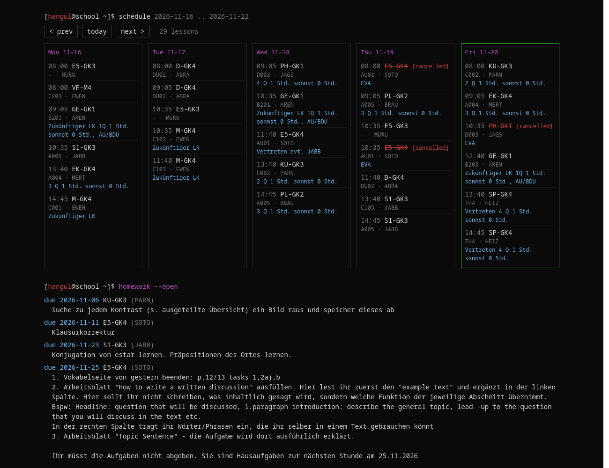

# Timetable-aware second brain for school

Loop: lesson -> notes -> tasks -> revision, driven by an agent that knows the WebUntis timetable.
See `docs/idea.md` for the pitch and `docs/structure.md` for the planned layout.

## Progress



**Done**
- Idea and project structure documented (`docs/`).
- WebUntis login works against our school (`hpg.webuntis.com`).
- Untis provider layer (`backend/app/untis/`): `real` and `mock` behind one interface, with timetable (rooms, cancellations, substitution notes), homework and `lesson_at(time)`.
- Shared models (`Lesson`, `Homework`, `Exam`).
- FastAPI backend (`/api/timetable`, `/api/homework`, `/api/analyze`) and a terminal-style web page showing the week's schedule and open homework (`web/index.html`).
- Agent core: paste a lesson transcript, get a structured note and a homework cross-check against Untis (spoken homework marked `[in untis]` or `[NOT IN UNTIS]`). Runs behind a stub LLM for now (`LLM_PROVIDER=stub`), so it costs nothing; real models plug in via the `LLMClient` interface.

**Known limits**
- Student accounts can't read exams from Untis (`no right for getExams()`), so exam dates need another source.
- The stub LLM is keyword-based, so real note quality needs Claude or a local model (Ollama, not built yet).
- Subjects are raw course codes (e.g. `E5-GK3`), not readable names yet.

**Next**
- Real LLM client (Ollama on the desktop PC, or Claude with an API key)
- Audio upload + transcription (faster-whisper)
- Untis poller + diff + Telegram alerts
- Quizzes and revision plan

## Run

```
python3 -m venv .venv && .venv/bin/pip install webuntis pydantic requests fastapi uvicorn
cp .env.example .env        # fill in Untis login; set UNTIS_PROVIDER=real or mock
.venv/bin/python backend/scripts/test_untis.py                   # login check
UNTIS_PROVIDER=mock .venv/bin/uvicorn app.main:app --app-dir backend   # then open localhost:8000
```
